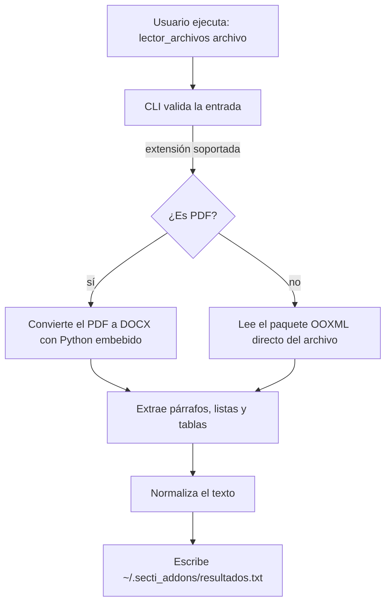

# 📖 Lector de Archivos

**Extrae el texto de tus documentos y lo deja en un solo archivo listo para leer, buscar o procesar.**

Un CLI ligero que lee **PDF, DOCX, PPTX y XLSX**, normaliza el contenido (párrafos, listas y tablas) y lo guarda en texto plano dentro de tu carpeta de usuario.

---

## ✨ Qué hace

| Formato | Cómo lo procesa |
|---|---|
| `.pdf` | Convierte a DOCX con **pdf2docx** (Python embebido) y extrae el texto |
| `.docx` | Lee el XML del documento (`word/document.xml`) |
| `.pptx` | Lee las diapositivas en orden (`ppt/slides/slideN.xml`) |
| `.xlsx` | Lee las hojas y filas del libro (`xl/workbook.xml` + hojas) |

Todo el resultado pasa por un limpiador de texto: símbolos repetidos colapsados, espacios normalizados y cierre de oración garantizado.

---

## 🚀 Uso rápido

```sh
# Con el ejecutable compilado
lector_archivos ruta/archivo.pdf

# O con Bun desde el repositorio
bun run index.ts ruta/archivo.pdf
```

### 📋 Opciones

| Opción | Descripción |
|---|---|
| `archivo` | **Obligatorio.** Ruta del documento (`.pdf`, `.docx`, `.pptx`, `.xlsx`) |
| `-t, --tablas` | Incluye las tablas del documento como filas (celdas separadas por coma) |
| `-h, --help` | Muestra la ayuda y sale |

Sin argumentos, el CLI muestra la ayuda y termina.

### 🧪 Ejemplos

```sh
lector_archivos informe.pdf
lector_archivos manual.docx --tablas
lector_archivos presentacion.pptx -t
lector_archivos concentrado.xlsx --tablas
```

---

## 📄 Dónde queda el resultado

Siempre en el mismo lugar, sin importar el formato de entrada:

```
~/.secti_addons/resultados.txt
```

El archivo se **sobrescribe** en cada ejecución y respeta este orden:

1. Título (primer párrafo del documento, en PDF y DOCX)
2. Párrafos
3. Listas (con prefijo `- `)
4. Tablas (una fila por línea, celdas unidas por coma)

En XLSX cada hoja con contenido aporta su nombre y luego sus filas; en PPTX las diapositivas se leen en orden.

> Sin `--tablas`, el contenido de las tablas se lee como párrafos sueltos. Con `--tablas`, las filas se agrupan y dejan de duplicarse en el texto.

---

## 📊 Flujo del proceso



*Cada flecha es automática; no necesitas intervenir.*

---

## 🛠️ Desarrollo

```sh
bun install                 # dependencias
bun run index.ts archivo    # ejecutar en modo desarrollo
bun test                    # smoke tests (builders + ejecutable)
bun build --compile index.ts --outfile lector_archivos.exe   # compilar el CLI
```

- **Runtime:** Bun. TypeScript `strict` + `noUncheckedIndexedAccess`.
- **Dependencias de producción:** solo `@xmldom/xmldom` y `adm-zip`.
- **Dependencias de desarrollo:** `exceljs` y `pptxgenjs`, usadas únicamente para generar fixtures de prueba.
- **Python:** nunca el del sistema; siempre el runtime embebido (`python/embedded`).

---

## 💡 Tips

- Verifica que la ruta del documento sea correcta y accesible.
- Para ver la ayuda al instante: `lector_archivos -h`.
- Ejecuta el CLI desde la raíz del proyecto: las dependencias de Python se resuelven con el directorio de trabajo (`__deps/site-packages`).
- Si compilaste el ejecutable, recuerda regenerarlo después de cualquier cambio en el código.

---

Hecho con ❤️ para facilitarte la vida. ¡Esperamos que sea tan útil para ti como lo es para nosotros!
