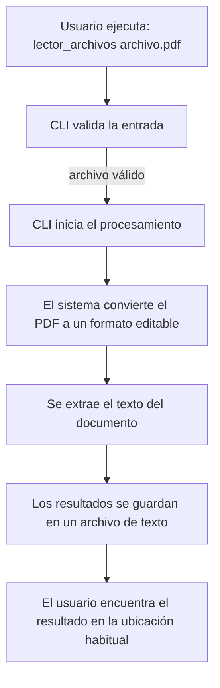

# 📖 Lector de Archivos – CLI

Bienvenido a la herramienta de línea de comandos que transforma tus PDFs en texto de forma rápida y sencilla.

---

## 🚀 Uso rápido

Ejecuta el CLI indicando la ruta de tu archivo PDF:

```sh
lector_archivos ruta/archivo.pdf
```

### 📋 Opciones

- `archivo.pdf` — **Ruta obligatoria** al archivo PDF que quieres procesar.
- `-h, --help` — Muestra este mensaje de ayuda y sale.

> Si no proporciona ningún archivo, el CLI mostrará la ayuda y terminará.

---

## 📊 Flujo del proceso

A continuación, un diagrama de flujo que muestra qué sucede cuando ejecutas el CLI:



*Cada flecha representa un paso automático; no necesitas intervenir.*

---

## 🛠️ ¿Qué obtienes?

- Un archivo de texto con el contenido extraído de tu PDF.
- La comodidad de ejecutarlo desde cualquier terminal.
- Ayuda integrada con `-h` o `--help` siempre que la necesites.

---

## 💡 Tips

- Asegúrate de que la ruta del PDF sea correcta y accesible.
- Si deseas ver la ayuda rápidamente, ejecuta `lector_archivos -h`.
- Los resultados se guardan en una carpeta oculta del sistema; busca `~/.secti_addons/resultados.txt` si necesitas verificarlo manualmente.

---

Hecho con ❤️ para facilitarte la vida. ¡Esperamos que sea tan útil para ti como lo es para nosotros!